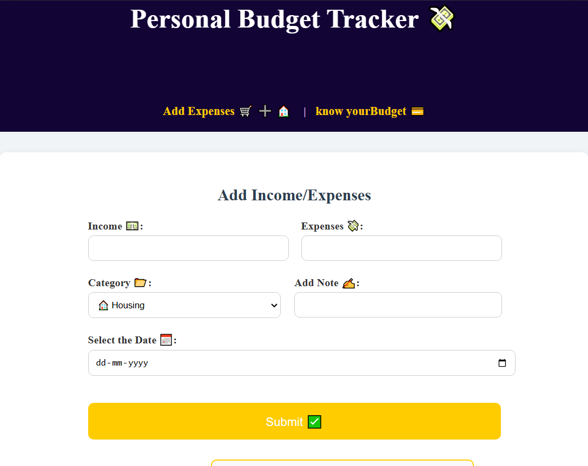

# 📒 Personal Budget Tracker 💸

> **Created by:** Nilesh Kadam

---

## 📋 Project Description

The **Personal Budget Tracker** is a simple and stylish web application designed to help users **track their income and expenses** easily.  
It allows you to:

- Add income and multiple types of expenses
- Categorize your expenses (Housing, Travel, Groceries, Healthcare, etc.)
- Add custom notes and select transaction dates
- View all expenses in a clean, organized table
- Get real-time **calculated balance** between income and expenses
- Submit feedback directly from the app!

This project is perfect for anyone looking to **manage personal finances** in an easy and intuitive way! 🧾✨

---

## 🛠️ Built With

- **HTML5**
- **CSS3** (inline styling)
- **JavaScript**

---

## 📸 Screenshots

| Home Page | Add Expenses Form | Expenses Table |
|:---------:|:-----------------:|:--------------:|
👉 

---

## 🎯 Features

- ✍️ **Add Income and Expenses**
- 📂 **Choose Expense Category**
- 📅 **Select Transaction Date**
- 📝 **Add Short Descriptions**
- 📊 **Dynamic Expenses Table**
- 💬 **Submit Feedback**

---

## 🚀 How to Use

1. Open the Link :
2. http://famous-marshmallow-030b7e.netlify.app

4. Start adding your income, expenses, and manage your budget efficiently!

---

## 💡 Future Scope (Upcoming)

- Add JavaScript to dynamically calculate **remaining balance** automatically.
- Store expenses **locally** using `localStorage`.
- Implement **data visualization** (Pie Charts / Bar Graphs) using libraries like **Chart.js**.
- Improve responsiveness for mobile devices (using Media Queries).

---

## 🙏 Acknowledgements

This project is developed as a part of my learning journey in Full Stack Development.  
Special thanks to all online communities and mentors supporting beginner developers! 💖

---

## 📬 Connect with Me

- LinkedIn: [Nilesh Kadam](www.linkedin.com/in/nilesh-kadam-07830522)
- Twitter / X: [@gw_min76921]

---

## 📜 License.  
Feel free to use, modify, and distribute! 🚀

---

# 🏁

> **“Keep building. Keep growing.” — Let's make budgeting easy and fun!** 🎉
